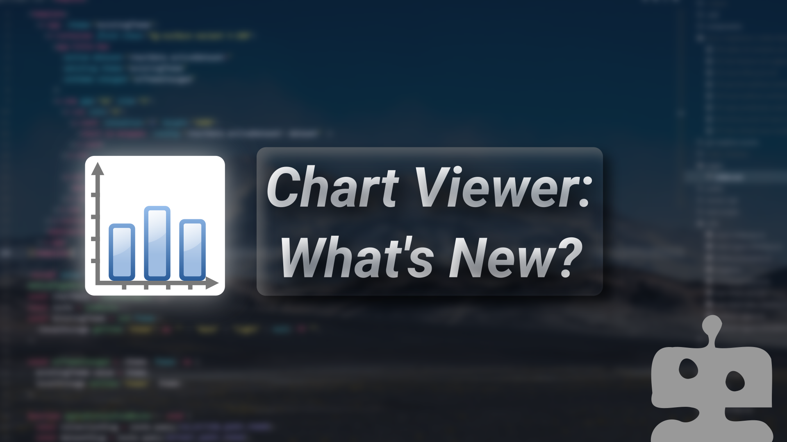
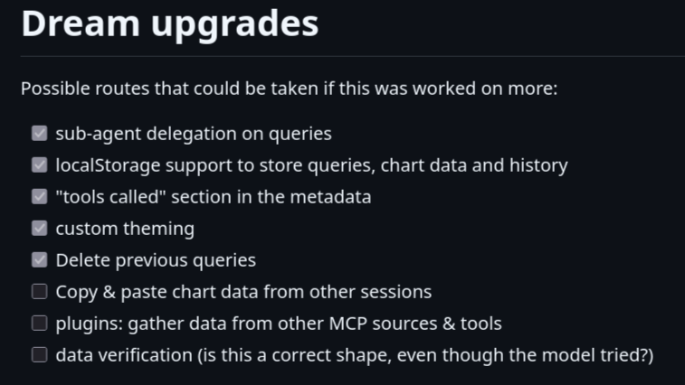
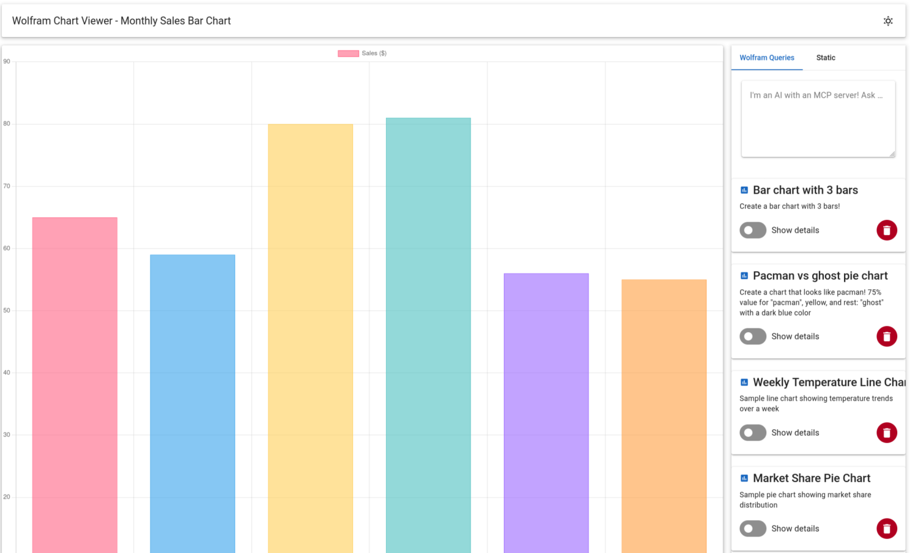
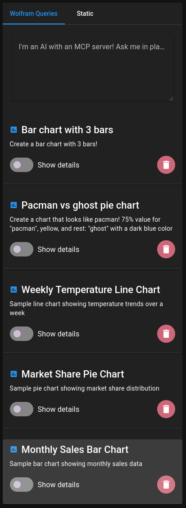
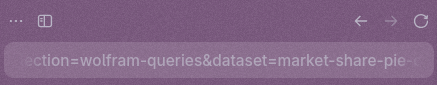
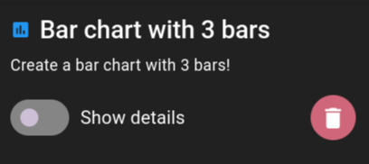
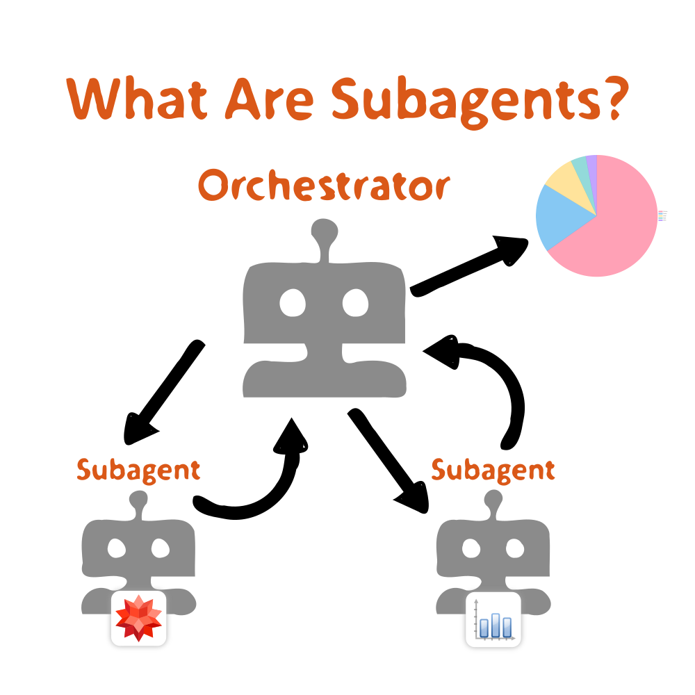
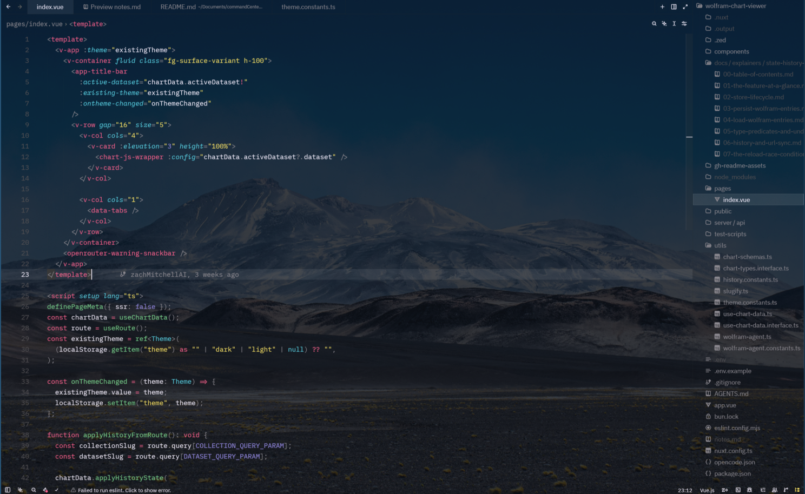

[The chart app](https://www.linkedin.com/pulse/how-i-learned-vue-built-agentic-chart-app-over-weekend-mitchell-zrtee/) has been seeing some changes over the past 13 days
since it's creation. On average, the commit history states that this
has been worked on every 2 days on average. Since the beginning of
the improvement phase, the project went from 11 commits at the start,
to **38** as of today.

Those are quite a few numbers. The main reason those are here is
to share that _progress is being made_. You might be asking -
"what _are_ those changes?!"

...You've come to the right place!

The wolfram chart viewer was built as a way for me to better
understand **Vue.js**. With the initial build though,
there are several things I wanted to have going at some point. It's
something I didn't want to leave hanging, especially since if it
_could_ be worked on, a few different things could be
demonstrated:

- More nuanced "taste" in coding standards
- A more true vision of what the app was meant to be
- Transparency on what it may take to develop beyond the
  prototype
- Questions about AI, and the "speed limit"
- Did I get it all in there yet?

All this and possibly more on today's TV cooking show of "Chart
Pie"!

Let's get into it!

## Table of contents

- What's new?
- What's refined?
- What does your "AI speedometer" look like?
- What hasn't been made yet?
- What's next?

## What's new?



A lot on this list has changed! We'll go over several of these
things (pictures included)

I realized both new and "refined" things intertwine with
eachother. We'll split them up though, because it's important to
distinguish user-facing issues, and cleanup / performance.

Let's go!

### Light Mode

Ok... close your eyes, and slowly peek open



Everything alright? Ok good my eyes love dark mode too, so just
wanted to make sure.

_However_, I fully acknowledge it's important to provide
this versatility. For all I know, it's possible someone might be
using this app in the bright sunlight and need a different contrast!

That little icon on the top right does work; that sun icon. It
switches between auto, dark, and light mode. Vuetify actually has
this theming built-right in. If the operating system is defaulting to
light, the website will be light, and vice versa.

The manual change though is nice during these one-off moments. It
could be dark mode by default and it's sunny out; conversely it's
probably bed time but you're curious about one little thing.

I mostly wrote this one by hand to learn about the process, with
nemotron refining types and constants.

### Queries now save in-browser



This is an important one to me personally!

You have some information you queried earlier today, but then you
need to turn off your laptop or close the browser... aaaand that data
is gone.

No bueno.

This update now allows persistence! It works through a combination
of things:

- localStorage
- pinia state management

The steps:

1. New query is submitted
2. Pinia checks the original collection
3. Adds it into it's working state, and a JSON string inside
   localStorage

If the page reloads, pinia re-opens the localStorage, puts it back
into the internal state, and the graphs can re-load as if it was the
same browser session!

### Viewing history



Did you forget which graph you were looking at a couple minutes
ago? Wanna chain through your queries in only a couple of steps?

Well, that works now! The app now uses the [Vue
Route API](https://router.vuejs.org/) to navigate back & forth without re-loading the
page. I've always liked this ability on pages because I can use the
secret forward & backward buttons on my mouse; not even a need to
touch the keyboard, or even the forward & back buttons on the
browser's UI itself.

This, along with the previous change where queries now save, make
this browsing experience much smoother! Browsing history gives urls
like these:

```
http://localhost:3000/?collection=wolfram-queries&dataset=market-share-pie-chart
```

You can then navigate to that specific one, the chart will load as if
you were still on the page before the re-load.

### Deleting entries



On top of the above, there is also the ability to now remove the
previous chart data. In that regard, there's _almost_ a full
collection of CRUD operations. (Create read update delete).

While for our purposes, it likely wouldn't make a lot of sense to
update, we _could_ have a different feature.

JSON

One thought I've had so far, is being able to grab the raw data in
order to transfer it to others. I don't think editing directly would
be useful because the goal would be to represent already created
data. (maybe correcting data is a possibility) However, being able to
_share_ data would be great. If done correctly, one of the
flows I think of is:

1. User clicks a "copy to clipboard" button
2. A structure with JSON / markdown is sent to another user
3. The recipient pastes this into the prompt box
4. The exact data is then saved as one of the queries

With this configured, sharing data would then be possible and
fast. It wouldn't even need to touch a server either.

## What's refined?

Ultimately, this category has a lot to do with under-the-hood
changes. Those are the things without eyecandy, but provide a lot of
functional value.

### Sub-agent delegation



What in the world does that mean?!

Well, in the first iteration of this app, **one LLM did
everything**. More specifically:

1. Understand the user's query
2. Figure out what to ask wolfram alpha
3. Call wolfram alpha _and_ receive a large corpus of
   info
4. Shape up a chart based on a _big_ templated
   structure... which contained every possible chart combination
5. Remember preferences the user asked at the very beginning of
   the context window
6. Send it back and hope it's not broken

That's hard! Like, _very_ hard. The biggest challenge here?
The model keeps _all of this_ in the head, might make multiple
calls to wolfram, and _then_ have to think about how charts
work.

The result? Yes, you can make charts, but they might be inaccurate
(hallucinated data), broken, or might not even display at all.

No bueno.

The fix?

**Sub-Agents**, so LLMs with fresh context, only the
tools it needs, and a new set of instructions for different tasks. We
have a big "orchestrator" to tell the subs what to do.
_Everyone only gets the directions, tools, and data they need for
their job to be done_.

Here's how it works _now_:

1. **Orchestrator** asks the wolfram agent: "Hey!
   Look up this general question for me!". He doesn't have tools,
   so he's unable to do it himself
2. **The first subagent** has the wolfram tool, and
   says: "Yes, let's search for a, b, and c". He _only_
   returns the raw answers to get the job done (no extra data)
3. The **Orchestrator** gets only this data back,
   _not the raw query or thinking the subagent did._ He now
   needs to think "hmm... what kind of chart should this be?"
4. Once decided, a **new subagent** that
   specializes in making a _specific_ chart type (pie, bar,
   scatter, bubble, etc) is asked to build the chart.
5. He finishes, returns it to the **orchestrator**.
   The orchestrator's last job is to send it all back.

This improves things by a lot! Some neat details behind this:

- The subagent bots are _tiny_. 31b parameters to be
  exact, they are gemma4 models instead of GLM5.2 doing everything.
  This means the process is much cheaper now
- Each chart has it's own subagent, in other words, there are 8
  sub-agents to be picked from. One for each chart type (instead of a
  monolith template!)
- One chart, one focus, much more optimized result

The stuff one single model has to worry about is now dramatically
smaller. We aren't juggling everything at once and praying for a
result! It now better follows a chained unix philosophy: do one task,
and do that task well.

### Separation of concerns


What does something like this mean?

It means the code has clear places to find the resources you need!
It's a habit which prevents people hunting around for things as the
code becomes larger.

Prior, a file may have several of these things all at once:

- interfaces
- single-use strings
- functional logic for a component
- Perhaps logic that would work better somewhere else, but was
  actually defined in a no-longer relevant part of the app.

All of this has been re-done to ensure growth is easier in the
long run. (Hey that rhymed!)

For example, interfaces may go to: chart-types.interface.ts

Conversely, strings may go to: wolfram-agent.constants.ts

Very simple things, but I think of two things that come out of
organizing like this:

1. _Much_ cleaner files; all of a sudden, things like
   agent prompts aren't overwhelming the actual logic side for example
2. It's possible now to quickly search for a file type when I
   hit CTRL + P on either VSCode or Zed (more on that!)

This move is going to be something that really depends on what
your needs are. I have a preference for this style because of former
projects I've worked on. You might not need this level of complexity
when starting out, but I think it's a good habit to pick up even if
it's just keeping your headspace clean.

### Vue files

Due to current limitations of vuejs and types, there is actually a
strange bug right now where types _can't_ be imported into a
.vue file. Until this issue is fixed, I'm instead cleaning up the vue
files to also having a standard of organization.

I've not seen other full codebase projects using vue (this has
been my first one!), but I thought I would sort it out like I would
if it were a vanilla HTML file:

- Styles on the top
- Template/body in the middle
- Script on the bottom

Before this, the files had all sorts of weird combinations. At
this point, they are all uniform now.

### The types back massage

The app legitimately got corrected on many different areas where
types were rough around the edges.

The first version of this app was built in a few days, but now
that there's a lot more time; types have been worked on and therefore
clarity has been optimized!

A bunch of this work was done by nemotron and kimi models

---

On the subject of models, that does bring up a valid question:

## What does your AI "speedometer" look like?


This time around, it varied quite a lot!

In the previous post about the wolfram chart viewer, I stated it
was about 30% code given to the LLMs.

I've since switched gears a little and experimented with different
speeds. If I were to identify some speeds, they would be:

1. All hand-written and researched
2. Half by hand, half by bot
3. Planned by hand, Fully by bot
4. Planned by hand and MCPs, written by bot
5. Fully by bot on all fronts

As for where these tie in with feature work:

- Light / Dark mode - 2
- Saved queries - 3
- Delete queries - 4
- History - 4
- Sub-agents - 2.5 (MCPs helped quickly grab resources)
- Separation of concerns / vue files / types back-massage - 5

With the types back massage being a weird exception, I manually
also worked on types to get rid of a large chunk not being used, but
otherwise fully automated.

---

Those are pretty direct answers, but then the question drops in:
what is enough AI? What is too much?

I think it really depends on what you're looking to accomplish.
When this project started, it was about learning the fundamentals of
vue, langchain, etc. Things were on a deep-dive previously on those
things.

Conversely, with other problems like dark / light mode, history,
separation of concerns - these are things that I not only know well,
but have seen routinely a lot.

---

Beyond the routine, what if the intent is one of these?

- Prototype
- Go beyond prototypes, and accelerate feature work,
  _intentionally_ automate feature work too (and associated
  grunt-work like PRs)
- Understand another approach (or "let me try a different
  approach" - as said by every AI I've seen as of late)

I mean, that's what everyone's doing in silicon valley right?
Prototype fast, build fast, and get features out _now_.

Well, if there's full understanding on what you're doing, then I'm
not against it. this project hasn't necessarily gone mach 10
specifically because I've been intentionally experimenting, taking
time to learn, and soak in anything new that I may or may not know.

That sounds ambiguous, but I'm also fascinated by _changing_
that speedometer from time-to-time. One day I might be writing by
hand, the other I may be flying through something. I'm not tied to a
deadline for a personal project like this, so for me this would
equivocate to me experimenting with gear shifting while on the road
for something non-urgent!

I actually _do_ have one fully automated project in the
pipeline right now, and that's been experimental on it's own. There's
a time & place for each style. I'm not necessarily going to
discount any level speed because regardless of how fast you'll go,
you'll learn something.

If the situation calls for fast, we'll go fast but navigate the
hurdles that go with it, same for slow. If I'm not doing one speed
for work, I'll do the other for personal. Learning at _every_
speed to me has it's place, and if you can exercise at each point,
then versatility will be a strong advantage in my opinion.

## What hasn't been made yet?

Switching gears a little bit!

Getting to the point, some stuff previously mentioned hasn't been
made:

- copy / paste JSON
- Adding additional MCP servers
- Format checking

I can foresee the json being straightforward. For MCP servers
though, I'll need to consider some stuff:

- Should the MCP settings be saved on client or server? (might
  side with server)
- Should the _configuring_ be possible on client? (it
  sure would be nice, but is it necessary?)
- Should there be a tab for each MCP?
- Can they be used together?

To a lot of these questions, they'll be a big experimentation
item. Up to this point, it's _been wolfram chart viewer_. But
I think strongly it would be cool to have more that are configurable.
It might introduce new things like **dynamic tabs;** instead
of just "static" and "wolfram" tabs, someone
could just make their own tab from scratch with settings they like.

That takes things to full versatility! Custom tabs, custom MCPs,
and also custom data.

## What's next?

Beyond this, there is an idea that just recently started to rattle
in my head a little bit...

While yes, currently this project has been constructed in Vue.js,
what if it was possible to have a _different_ front-end? Maybe
more than just one... but possibly even 4? What if they all hard
parity with each-other after just one of those codebases changed?
What if that parity though... _wasn't made by you?_

---

This is a weird idea, but in today's world, I would argue it could
be possible. This project is far from ready from doing something like
that just yet. To expand on this a little more though, here's what
I'm thinking might be neat as an experiment:

- After the Vue variant is finished, some core libraries could
  be extracted (agentics, configuration, etc)
- More front-ends could be created: react, vanilla js, possibly
  even a TUI
- After someone changes any one of those (react, vue, vanilla,
  tui), an agentic workflow could be kicked off to edit all the
  others, ensure it's tested, is reviewed vigorously, and eventually
  rippled out into everything else.
- Full feature parity amongst everything

That part is a dream - would it get taken on? Good question! We
have to get through the core features of this codebase first! Doing
this would also be very token heavy if we're not using free tier
stuff (I'm currently riding nemotron ultra when bandwidth is good).
Cheaper models like Kimi and GLM have also been good for this
project.

The benefit of the non-TUI versions of an app like this would be,
that each of these frameworks would have a lot of similarity to them,
more specifically things like google's Material translates over to
Material UI, and Vuetify. For a TUI version of this, it would be a
little different, but wouldn't be impossible.

I share it early because of the possibilities behind it - there
have been ports of games or other apps before; they all have their
ups & downs. Though the way I'm seeing this is interesting,
because in a way, it's a self shape-shifting rosetta stone if we put
the pieces together. A human _could_ do all this on their own,
but let's say the font changes, or a component for pressing a button
is inserted - all codebases don't _have_ to need a human doing
all that work, if the change itself can quickly be shifted into place
without direct intervention.

It's experimental, yes - but to me this teases a neat idea that
could maybe translate into other areas beyond just making ports of an
application. Once the craft itself begins to shape, real workflows
could maybe pan out for a different style of project all together.
For example a PDF could be written in English, but then chunked,
understood, refined, and pushed out to several other languages in
this process (remember translategemma ?)

To get the idea out there and in practice could help shape the
concept, and I'm here for it.

## Bonus: Zed



I thought this would be a fun share because it was mentioned
earlier in the blog post - I've lately been trying out zed after
using VSCode for virtually my entire career (and before that!). Aside
from being absolutely _gorgeous_, there are a few other
highlights:

- It's written in rust (in contrast to VSCode's electron)
- The net RAM usage is more efficient
- Utilizes the GPU to render the text, making the rendering
  very smooth
- Native AI support (+ ACP) \*

Objectively it's been a very neat ride; I especially had some fun
customizing it to my Linux desktop. It's intentionally transparent
right now to view the desktop wallpaper from behind! That means the
editor is always showing something new whenever the desktop opens (my
desktop has a wallpaper shuffler)

Would I recommend it to everyone? I'll be transparent and say it
has some work to be navigated around first of all. On one side its
_really_ fast. Conversely, things like it's AI features use
the GPU extensively; not for using the tokens themselves mind you,
but to _render the streaming text_ you you get back from a
cloud model. This means that you might hear your fans run on an
integrated laptop like mine for something like that.

Zed also has built-in **ACP support**, which in
laymen's terms means you can connect your favorite harness (for me
that's opencode), like a lego brick and it just works. That's a great
win. I added an asterisk above though for the following things they
need to iron out:

- There is one ACP instance for each working window (I get
  this, since opencode only works with a single project at a time).
  That boosts RAM consumption if you have MCPs already booting up.
- For opencode & ACP, it doesn't pick up the project level
  config, which means it won't use opencode.json at the root of a
  project. Big tradeoff if you like to have specific MCP server
  configs or perhaps pre-made subagents for that project.
- Zed _itself_ doesn't have project-level MCP config,
  only global. The interface is good for toggling them, but you'll
  have to be conscious of what needs to be changed.

Opencode global configs _do_ however in fact work out of
the box, since brave-search for me is on by default, it picked that
up immediately.

The editor overall is very nice. It has some bumps to work on for
the AI stuff (which they're featuring heavily), but I'm a big fan
overall. While it's possible I may disable AI features and just stick
with the opencode CLI to keep a minimal GPU and RAM footprint, it's
still fun to make use of the AI features already baked; I hope the
development of this editor continues, it's a good all-in-one package
so far!

(If nothing else, they also have a terminal sidebar where the AI
features go; opencode can live here!)

## Fin

There's quite a lot here - and I think I said that near the
beginning too.

The overall goal of this blog post was to say - "I'd like to
follow-up on that project"; and with enough verbosity, I think
that was achieved, and more!

If the project continues, it would be cool to see the base pieces,
and possibly wild ideas go into fruition.

I'll go ahead and do something though that I was recommend to
start doing in these posts! Let me ask you:

What would be
something you'd like to see out of the project?

Or better yet:

What are some
things you'd do to the project if you were expanding on it?

Always interesting to hear about other's opinions. If you got 'em,
send them over here!

Thanks for checking this post out, hope the day is a good one!

# Hello from LinkedIn!

Like last time, this was re-formatted through a pipeline to port over to github! The original page is over here: https://www.linkedin.com/pulse/chart-viewer-following-up-new-features-zachary-mitchell-mxhfe/

The short version of how this conversion works: LinkedIn Blog Editor -> Libre Office Writer -> "Save as HTML" (Not export) -> `markitdown file.html > README.md` -> LLM renames file names -> final adjustments
